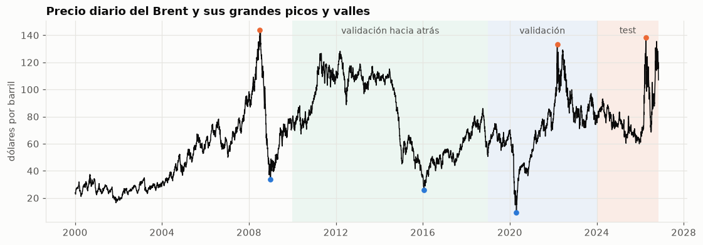
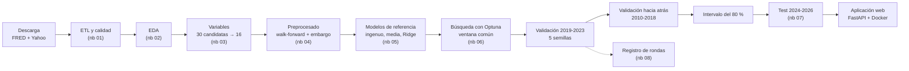
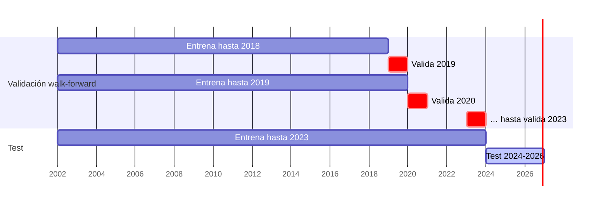
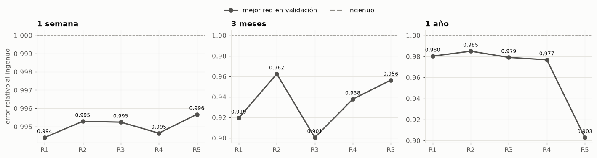
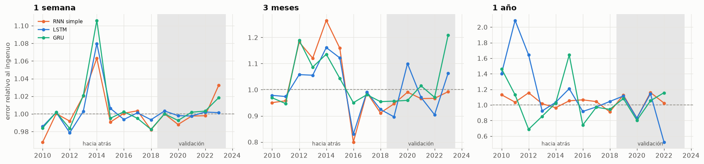
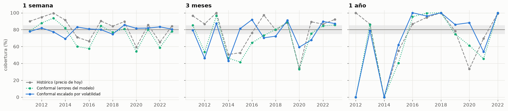
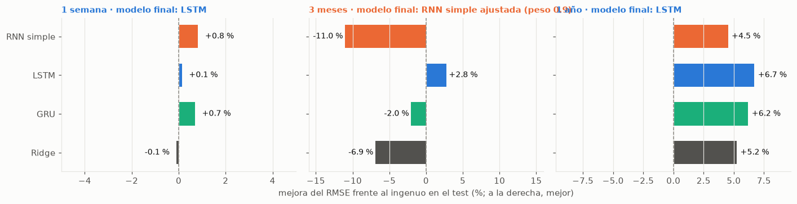
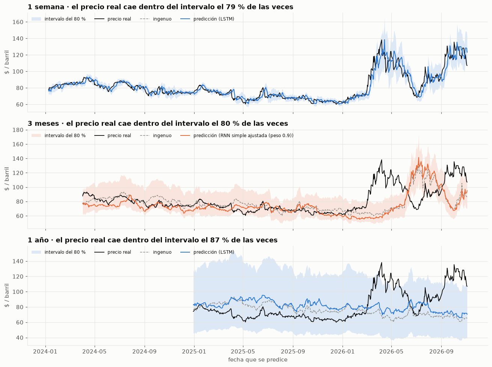
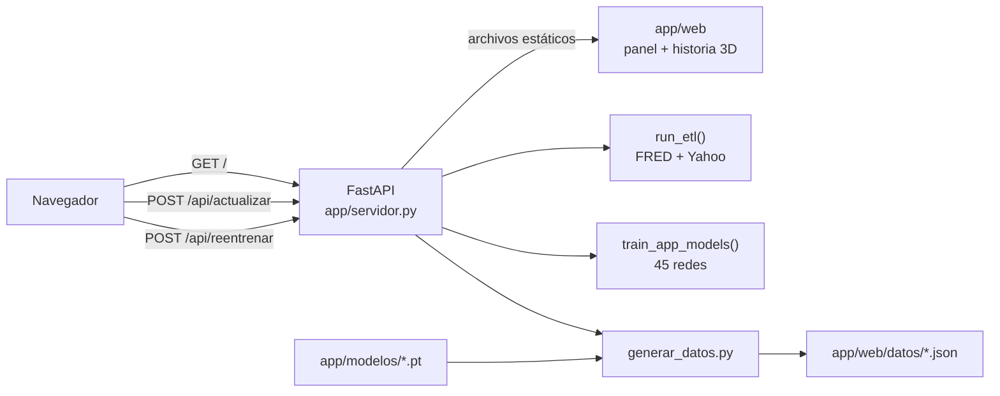

# Predicción del precio del petróleo Brent con RNN, LSTM y GRU


Caso práctico de Aprendizaje Automático: comparación de tres redes neuronales recurrentes (**RNN simple, LSTM y GRU**) para predecir el precio del Brent a **1 semana (5 días hábiles), 3 meses (63) y 1 año (252)**, e integración del modelo final en una **aplicación web** que da la previsión, su **intervalo del 80 %** y una explicación en lenguaje sencillo de lo fiable que es.

El enunciado completo está en [`docs/assignment/ENUNCIADO.pdf`](docs/assignment/ENUNCIADO.pdf).

<p align="center">
  
  
</p>

## Resultados en una tabla

Error en el **test (enero de 2024 → noviembre de 2026)**, medido como RMSE en dólares **relativo al modelo ingenuo** («el precio dentro de *h* días será el de hoy»): **1 es empatar con el ingenuo y por debajo de 1 es mejorarlo**.

| Plazo | RNN simple | LSTM | GRU | Ridge (lineal) | Modelo final (elegido en validación) | Intervalo 80 %: cobertura en el test |
|---|---|---|---|---|---|---|
| 1 semana | **0,992** | 0,999 | 0,993 | 1,001 | LSTM → 0,999 | 79 % |
| 3 meses | 1,110 | **0,972** | 1,020 | 1,069 | RNN simple (peso 0,9) → 1,094 | 80 % |
| 1 año | 0,955 | **0,933** | 0,938 | 0,948 | LSTM → **0,933** (+6,7 %) | 87 % |

- **1 semana:** ninguna red se separa del ingenuo. A este plazo el precio de mañana es casi el de hoy, y lo útil es el intervalo, que acierta el 79 % de las veces y se mantiene estable año a año.
- **3 meses:** la LSTM mejora al ingenuo un 2,8 %, pero la red elegida en validación (RNN simple) no se sostiene en el test y es muy inestable entre semillas.
- **1 año:** la LSTM, que es el modelo final, mejora al ingenuo un **6,7 %** con las 5 semillas a favor. La GRU queda muy cerca (+6,2 %).
- Ninguna mejora es estadísticamente significativa (test de Diebold-Mariano, p > 0,05): batir al ingenuo en el precio del petróleo es muy difícil, y con dos años de test la potencia es baja.

---

## Índice

1. [El problema](#1-el-problema)
2. [Datos](#2-datos)
3. [Pipeline de trabajo](#3-pipeline-de-trabajo)
4. [Metodología](#4-metodología)
5. [Cómo se llegó al modelo final](#5-cómo-se-llegó-al-modelo-final)
6. [Validación y validación hacia atrás](#6-validación-y-validación-hacia-atrás)
7. [Intervalo del 80 %](#7-intervalo-del-80-)
8. [Resultados en el test](#8-resultados-en-el-test)
9. [Conclusiones y limitaciones](#9-conclusiones-y-limitaciones)
10. [Aplicación web](#10-aplicación-web)
11. [Cómo reproducirlo](#11-cómo-reproducirlo)
12. [Estructura del repositorio](#12-estructura-del-repositorio)

---

## 1. El problema

Una empresa que compra combustible necesita saber cuánto costará el barril **dentro de una semana** (compras inmediatas), **dentro de tres meses** (presupuesto del trimestre) y **dentro de un año** (planificación y coberturas). El enunciado pide:

- Entrenar **RNN simple, LSTM y GRU** con las mismas condiciones (misma ventana de entrada, mismo presupuesto de búsqueda) para los tres horizontes.
- Validar con **walk-forward** (nunca entrenar con el futuro) y compararlas con un **modelo ingenuo**.
- Una tabla con **MAE, RMSE, mejora frente al ingenuo, número de parámetros y tiempo de entrenamiento**.
- Una **aplicación** que dé la previsión con un **intervalo del 80 %** y la explique.

El listón es el **modelo ingenuo**: el precio de hoy como previsión de cualquier fecha futura. Es la referencia estándar en precios de materias primas, y es difícil de batir porque el precio se comporta casi como un paseo aleatorio.

## 2. Datos

21 series diarias desde el 1 de enero de 2000 hasta el 3 de noviembre de 2026 (6.501 días con precio del Brent), descargadas de fuentes públicas:

| Fuente | Series |
|---|---|
| **FRED** (Reserva Federal de St. Louis) | Brent y WTI al contado, gas natural Henry Hub, tipo de depósito del BCE, USD/EUR, CNY/USD, VIX |
| **Yahoo Finance** | Futuros del Brent y del WTI (apertura, máximo, mínimo, cierre y volumen), futuros de gas natural, cobre, oro, índice del dólar |

<p align="center"></p>

La serie incluye todos los grandes episodios: el máximo de 2008, la crisis financiera, el exceso de oferta de 2014-2016, el COVID-19 (con el WTI en negativo), la invasión de Ucrania y, dentro del test, la **guerra con Irán y el cierre del estrecho de Ormuz en 2026**, cuando el Brent pasó de 61 $ a 127 $ en un trimestre.

**Variables del modelo (16, elegidas en el notebook 03):**

| Grupo | Variables |
|---|---|
| Retornos diarios | Brent, futuro del WTI, futuro del gas, oro, cobre, índice del dólar, CNY/USD |
| Régimen de mercado | volatilidad a 21 y 63 días, caída desde el máximo del último año |
| Estructura y valor relativo | diferencial Brent-WTI, *basis* del WTI, ratios cobre/Brent y oro/Brent normalizados |
| Riesgo y política monetaria | log del VIX, cambio del tipo del BCE en 63 días |

## 3. Pipeline de trabajo



| Notebook | Contenido |
|---|---|
| [`01_etl_calidad_datos`](notebooks/01_etl_calidad_datos.ipynb) | Extracción, alineación de calendarios, antigüedad del dato, valores atípicos y decisiones de limpieza |
| [`02_eda`](notebooks/02_eda.ipynb) | Ciclos del precio, propiedades estadísticas, estacionalidad, relación con otros mercados e incertidumbre por horizonte |
| [`03_feature_engineering`](notebooks/03_feature_engineering.ipynb) | 30 variables candidatas, redundancia, relevancia, estabilidad en el tiempo y selección final de 16 |
| [`04_preprocesamiento`](notebooks/04_preprocesamiento.ipynb) | Objetivo de cada horizonte, walk-forward con embargo, escalado sin fugas y secuencias de 20 días |
| [`05_baselines`](notebooks/05_baselines.ipynb) | Modelo ingenuo, media histórica y regresión Ridge: el listón para las redes |
| [`06_ajuste_hiperparametros`](notebooks/06_ajuste_hiperparametros.ipynb) | Cómo funciona cada celda, la elección de la ventana común, la búsqueda y las arquitecturas finales |
| [`07_comparativa_modelos`](notebooks/07_comparativa_modelos.ipynb) | Test: tabla comparativa, estabilidad entre semillas, predicciones, intervalo, coste y conclusiones |
| [`08_registro_experimentos`](notebooks/08_registro_experimentos.ipynb) | Todas las rondas de experimentos: qué se probó, qué salió y qué se decidió, con curvas de aprendizaje |

## 4. Metodología

### Qué predicen las redes

Las redes no predicen el precio, sino el **retorno logarítmico a *h* días**, log(P<sub>t+h</sub> / P<sub>t</sub>), que es mucho más estable en el tiempo que el precio. La previsión en dólares es P<sub>t</sub> · e<sup>retorno</sup>. Así, una red que predice retorno 0 es exactamente el modelo ingenuo, y cualquier mejora sobre él es información que la red ha encontrado en los datos.

### Validación sin mirar al futuro



- **Walk-forward por años:** para cada año de validación (2019 a 2023) se entrena solo con lo anterior. El error de validación es la media de los cinco años.
- **Embargo de *h* días** entre entrenamiento y evaluación: el objetivo de los últimos ejemplos de entrenamiento no puede caer dentro del periodo evaluado (a 1 año, eso supone dejar fuera 252 días).
- **Escalado sin fugas:** cada pliegue se normaliza solo con estadísticas de sus datos de entrenamiento. Hay tests automáticos que lo comprueban ([`tests/test_no_leakage.py`](tests/test_no_leakage.py)).
- **Parada temprana** con el último 15 % del entrenamiento (respetando también el embargo): máximo 150 épocas y paciencia 15.

### Condiciones iguales para las tres redes

| | RNN simple, LSTM y GRU |
|---|---|
| Ventana de entrada | **20 días**, la misma para las tres (elegida entre 20 y 60 con una regla fijada de antemano) |
| Arquitectura | capa recurrente (1-2 capas de 16, 32 o 64 neuronas) + capa lineal de salida |
| Búsqueda | Optuna (TPE), **30 intentos por red y horizonte, 2 semillas por intento**, poda de intentos malos (*MedianPruner*) |
| Espacio de búsqueda | neuronas, capas, *dropout* 0-0,5, *learning rate* 3·10⁻⁵-10⁻³, lote 64/128/256, *weight decay* 10⁻⁶-10⁻³, pérdida MSE o Huber |
| Evaluación | media de **5 semillas** (*ensemble*); su dispersión mide la estabilidad |

### Reglas fijadas antes de mirar los resultados

Cada decisión (ventana, variante, peso de ajuste, modelo final, método del intervalo) se tomó con una **regla escrita antes de calcular**, guardada junto a los resultados en `reports/results/ronda_5/*_decision.json`. La versión **ajustada** de una red multiplica su retorno previsto por un peso entre 0 y 1 elegido en validación: con peso 0 es el ingenuo, y sirve para no sobreactuar cuando la red aporta poco.

## 5. Cómo se llegó al modelo final

El modelo se construyó por rondas. Cada ronda prueba una idea y se decide siempre con la validación 2019-2023. El detalle completo, con todas las tablas, está en el [notebook 08](notebooks/08_registro_experimentos.ipynb).

<p align="center"></p>

| Ronda | Qué se probó | Qué se aprendió |
|---|---|---|
| 1 | Primera búsqueda: 20 intentos por red, ventana de 60 días, 1 semilla | Con una sola semilla la validación es optimista |
| 2 | Búsqueda más amplia, validación con 5 semillas, versión ajustada | Cifras más realistas; cada red elegía su propia ventana, y el enunciado pide la misma |
| 3 | *Ensembles* de las 5 mejores configuraciones, más peso a los años recientes, modelo lineal en paralelo | Los *ensembles* ayudan; dar más peso a lo reciente empeora |
| 4 | Más semillas, menos variables, curvas de aprendizaje | Parte de la mejora anterior era azar; LSTM y GRU tenían demasiada capacidad y memorizaban |
| **5** | **Ventana común de 20 días**, nueva búsqueda con redes más pequeñas, sin tendencia del periodo de entrenamiento | **Modelo final**: cumple todas las condiciones del enunciado |

**Configuración final de cada red** (ventana de 20 días en todas; pérdida Huber en todas):

| Plazo | Red | Neuronas × capas | *Dropout* | *Learning rate* | Lote | Parámetros |
|---|---|---|---|---|---|---|
| 1 semana | RNN simple | 16 × 1 | 0,34 | 4,2·10⁻⁴ | 256 | 561 |
| | LSTM | 16 × 2 | 0,39 | 4,5·10⁻⁵ | 128 | 4.369 |
| | GRU | 32 × 1 | 0,17 | 3,8·10⁻⁵ | 256 | 4.833 |
| 3 meses | RNN simple | 64 × 2 | 0,47 | 6,9·10⁻⁴ | 128 | 13.633 |
| | LSTM | 64 × 1 | 0,01 | 7,2·10⁻⁴ | 128 | 21.057 |
| | GRU | 32 × 2 | 0,02 | 3,5·10⁻⁵ | 128 | 11.169 |
| 1 año | RNN simple | 16 × 2 | 0,04 | 3,1·10⁻⁵ | 256 | 1.105 |
| | LSTM | 32 × 2 | 0,20 | 3,0·10⁻⁵ | 128 | 14.881 |
| | GRU | 32 × 2 | 0,06 | 3,1·10⁻⁵ | 128 | 11.169 |

## 6. Validación y validación hacia atrás

**Validación walk-forward 2019-2023** (RMSE relativo al ingenuo, media de los cinco años):

| Plazo | RNN simple | LSTM | GRU | Ridge | Modelo final |
|---|---|---|---|---|---|
| 1 semana | 1,003 | **1,000** | 1,003 | 0,998 | LSTM |
| 3 meses | **0,972** | 0,987 | 1,022 | 1,004 | RNN simple, peso 0,9 (0,972) |
| 1 año | 1,036 | **0,903** | 1,024 | 0,985 | LSTM |

El **modelo final** de cada horizonte es la red con menor error en validación, y quedó apuntado en [`modelo_final.json`](reports/results/ronda_5/modelo_final.json) antes de calcular el test.

**Validación hacia atrás (2010-2018).** Cinco años de validación son pocos, y todas las decisiones se tomaron con ellos. Para comprobar si la ventaja es real, las configuraciones elegidas se reentrenaron **sin cambiar nada** para cada año de 2010 a 2018, solo con los datos anteriores a ese año. Regla: un modelo *se sostiene* si su error medio en todos los años (2010-2023) es menor que 1 y gana al ingenuo en al menos la mitad.

<p align="center"></p>

| Plazo | Modelo final | Media 2010-2023 | Años que gana | Veredicto |
|---|---|---|---|---|
| 1 semana | LSTM | 1,003 | 6 de 14 | no se sostiene (≈ ingenuo) |
| 3 meses | RNN simple, peso 0,9 | 1,008 | 10 de 14 | dudoso |
| 1 año | LSTM | 1,142 | 5 de 13 | no se sostiene |

Las redes aprenden sobre todo un patrón: **rebote tras una caída fuerte y volátil**. Acierta en 2009, 2016 y 2020, pero falla en 2014-2015 (la caída siguió) y en 2011-2013 (precio plano, donde el ingenuo es casi imbatible). La validación hacia atrás no cambia el modelo final, pero anticipa qué esperar en el test: a 1 semana empate y a 3 meses resultado frágil.

## 7. Intervalo del 80 %

Se compararon tres métodos, calibrando cada año solo con lo que se sabía antes del 1 de enero de ese año:

| Método | Cómo se construye |
|---|---|
| **Histórico** | Centrado en el precio de hoy, con los percentiles 10 y 90 de los movimientos pasados a *h* días |
| **Conformal** | Centrado en la previsión de la red, con los percentiles de sus errores pasados |
| **Conformal escalado por volatilidad** | Como el conformal, pero los errores se dividen por la volatilidad de cada día y se multiplican por la de hoy: se ensancha cuando el mercado se agita |

**Regla:** entre los métodos con cobertura entre el 75 % y el 85 %, gana la menor puntuación de intervalo (anchura más penalización cuando el precio cae fuera); uno más sencillo a menos del 2 % gana.

<p align="center"></p>

| Plazo | Método elegido | Cobertura 2011-2023 (a 1 año, 2012-2022) | Cobertura en el test |
|---|---|---|---|
| 1 semana | Conformal escalado por volatilidad | 79,8 % | 78,9 % (77-80 % cada año) |
| 3 meses | Histórico | 78,9 % | 79,8 % (40 % en 2026) |
| 1 año | Histórico | 72,9 % | 87,0 % (orientativo, muy ancho) |

## 8. Resultados en el test

Cada red se entrena con todos los datos anteriores a 2024 (con embargo) y 5 semillas. El test va de enero de 2024 al último día con objetivo conocido.

### Tabla comparativa (requisito del enunciado)

| Plazo | Modelo | MAE ($) | RMSE ($) | Mejora RMSE vs ingenuo | Parámetros | Tiempo por semilla |
|---|---|---|---|---|---|---|
| **1 semana** | Ingenuo | 3,85 | 5,82 | — | 0 | — |
| | Media histórica | 3,85 | 5,82 | 0,0 % | 1 | — |
| | Ridge | 3,85 | 5,83 | −0,1 % | 961 | — |
| | RNN simple | 3,83 | 5,77 | **+0,8 %** | 561 | 1,2 s |
| | LSTM | 3,85 | 5,81 | +0,1 % | 4.369 | 7,1 s |
| | GRU | 3,83 | 5,78 | +0,7 % | 4.833 | 5,7 s |
| **3 meses** | Ingenuo | 12,83 | 20,06 | — | 0 | — |
| | Media histórica | 12,91 | 20,05 | +0,1 % | 1 | — |
| | Ridge | 13,17 | 21,44 | −6,9 % | 961 | — |
| | RNN simple | 14,69 | 22,27 | −11,0 % | 13.633 | 2,8 s |
| | LSTM | 12,87 | 19,50 | **+2,8 %** | 21.057 | 3,0 s |
| | GRU | 12,79 | 20,47 | −2,0 % | 11.169 | 13,8 s |
| **1 año** | Ingenuo | 19,76 | 25,80 | — | 0 | — |
| | Media histórica | 21,22 | 25,52 | +1,1 % | 1 | — |
| | Ridge | 17,51 | 24,45 | +5,2 % | 961 | — |
| | RNN simple | 19,13 | 24,63 | +4,5 % | 1.105 | 4,7 s |
| | LSTM | 19,90 | 24,07 | **+6,7 %** | 14.881 | 9,2 s |
| | GRU | 17,43 | 24,20 | +6,2 % | 11.169 | 7,8 s |

<p align="center"></p>

### El modelo final frente a la realidad

<p align="center"></p>

| Plazo | Modelo final | Validación | Test | Lectura |
|---|---|---|---|---|
| 1 semana | LSTM | 1,000 | 0,999 | Igual que en validación: empata con el ingenuo |
| 3 meses | RNN simple, peso 0,9 | 0,972 | 1,094 | No se sostiene; la validación hacia atrás ya lo marcaba como dudoso |
| 1 año | LSTM | 0,903 | **0,933** | Mejora al ingenuo en validación y en el test, con las 5 semillas a favor |

**Qué decide el resultado:** el shock de 2026. A 1 año, la LSTM pierde en 2025 (anticipaba precios más altos de los que hubo) y gana en 2026, cuando la guerra llevó el precio a la zona que predecía. A 3 meses, la GRU y Ridge iban bien en 2024-2025 y pierden en 2026. El análisis año a año y la ventaja acumulada frente al ingenuo están en el [notebook 07](notebooks/07_comparativa_modelos.ipynb).

## 9. Conclusiones y limitaciones

1. **A 1 semana ninguna red aporta sobre el ingenuo**, como cabe esperar en precios de materias primas. Aquí el valor está en el **intervalo**: el método conformal escalado por volatilidad cubre el 79 % en el test y se mantiene estable incluso en 2026.
2. **A 3 meses los resultados son frágiles.** La red mejor en validación (RNN simple) pierde un 9,4 % en el test y varía mucho entre semillas: sus curvas de aprendizaje muestran que alcanza su mejor punto en pocas épocas y luego memoriza. La LSTM, más estable, mejora un 2,8 %.
3. **A 1 año la LSTM mejora al ingenuo un 6,7 %**, y la GRU un 6,2 %. Es el único horizonte en el que el modelo final gana en validación y en el test.
4. **Entre arquitecturas, la LSTM es la más consistente**: es la única que mejora al ingenuo a 3 meses y a 1 año, en validación y en el test. La RNN simple es la más barata de entrenar, pero la más inestable. La GRU queda en medio.
5. **Una regresión lineal (Ridge) queda cerca** a 1 año (+5,2 %): con unos 6.000 días de datos y un problema tan ruidoso, la ventaja de las redes recurrentes es pequeña.

**Limitaciones:**
- Ninguna diferencia con el ingenuo es significativa: el test tiene menos de tres años, y a 1 año las predicciones se solapan casi por completo.
- El resultado depende mucho de un único shock (2026). Con otro periodo de test, la ordenación de las redes podría cambiar.
- Los modelos solo ven datos de mercado. No tienen información de oferta (OPEP+, inventarios) ni de geopolítica, que son las que mueven los grandes cambios de precio.

## 10. Aplicación web

La aplicación está en [`app/`](app/): un servidor **FastAPI** que sirve una web estática (HTML, CSS y JavaScript, con una historia en 3D hecha con Three.js) y ejecuta los modelos en Python.

**Qué ofrece:**
- **Panel:** previsión a 1 semana, 3 meses y 1 año con su intervalo del 80 % y un **indicador de fiabilidad** por plazo (*aporta valor*, *orientativa* o *poco fiable*), calculado a partir de los resultados del test.
- **Escenarios:** probabilidad de que el precio supere un umbral, con la distribución del intervalo.
- **Fiabilidad:** lo que predijo el modelo en el test frente a lo que pasó.
- **Modelo:** comparación de las tres redes en cada plazo.
- **Datos:** dos botones que llaman al backend: **actualizar datos** (descarga lo último de FRED y Yahoo y recalcula la previsión con los modelos guardados) y **reentrenar** (vuelve a entrenar las redes con todos los datos, en segundo plano).
- **Historia:** un recorrido en 3D por los grandes picos y valles del Brent desde 2000.



La aplicación usa el modelo final **reentrenado con todos los datos disponibles** (5 semillas de cada red y horizonte, 45 modelos pequeños, 1,8 MB en total).

**Ejecutarla en local:**

```bash
poetry run uvicorn servidor:app --app-dir app --port 7860
```

y abrir <http://localhost:7860>.

**Desplegarla en Hugging Face Spaces** (Docker):

```bash
poetry run python scripts/preparar_space.py
```

```bash
hf upload <usuario>/<space> build/space . --repo-type space
```

El primer comando monta en `build/space/` todo lo que necesita el Space (servidor, web, modelos, paquete `oil_forecast`, datos, [`Dockerfile`](app/Dockerfile) y [`requirements.txt`](app/requirements.txt)) y el segundo lo sube.

## 11. Cómo reproducirlo

Requisitos: Python 3.12 o 3.13 y [Poetry](https://python-poetry.org/docs/#installation).

```bash
poetry install
```

| Paso | Comando | Resultado |
|---|---|---|
| 1. Datos | `poetry run python scripts/download_data.py` | `data/petroleo_dataset.csv` y `data/metadata.json` |
| 2. Búsqueda | `poetry run python scripts/tune.py --all` | Estudios de Optuna en `reports/tuning/ronda_5/` |
| 3. Ventana común | `poetry run python scripts/tune.py --decidir-ventana` | `ventana_decision.json` |
| 4. Validación | `poetry run python scripts/train.py validacion` | `validacion_resumen.csv`, `modelo_final.json` |
| 5. Validación hacia atrás | `poetry run python scripts/train.py hacia_atras` | `hacia_atras_resumen.csv` |
| 6. Intervalo | `poetry run python scripts/intervalo.py` | `intervalo_decision.json` |
| 7. Test | `poetry run python scripts/train.py test` | `comparativa.csv`, `predicciones_test.csv` |
| 8. Curvas de aprendizaje | `poetry run python scripts/curvas.py` | `reports/results/ronda_5/curvas/` |
| 9. Modelos de la app | `poetry run python scripts/entrenar_app.py` | `app/modelos/` y `app/web/datos/` |
| 10. Figuras del README | `poetry run python scripts/figuras_readme.py` | `docs/img/` |

Los scripts de entrenamiento aceptan `--nucleos N` para limitar los procesos en paralelo. Los resultados de la ronda final ya están en el repositorio, así que los notebooks se pueden ejecutar sin volver a entrenar (solo necesitan el paso 1).

**Tests y estilo:**

```bash
poetry run pytest
```

```bash
poetry run ruff check .
```

Los tests comprueban, entre otras cosas, que no haya fugas de información del futuro (escalado, embargo, calibración del intervalo), la forma de las redes y el entrenamiento.

## 12. Estructura del repositorio

```
├── app/                      Aplicación web
│   ├── servidor.py           FastAPI: sirve la web y los endpoints /api/*
│   ├── generar_datos.py      Escribe los JSON que lee la web
│   ├── modelos/              Redes entrenadas con todos los datos (.pt) y su especificación
│   ├── web/                  Panel, historia 3D y datos (JSON)
│   ├── Dockerfile            Imagen para Hugging Face Spaces
│   └── requirements.txt      Dependencias del Space (PyTorch para CPU)
├── docs/
│   ├── assignment/           Enunciado
│   └── img/                  Figuras del README
├── notebooks/                01-08, del ETL a la comparativa final
├── reports/
│   ├── results/ronda_N/      Validación, decisiones, test, intervalo y curvas
│   └── tuning/ronda_N/       Estudios de Optuna y mejores configuraciones
├── scripts/                  Descarga, búsqueda, entrenamiento, intervalo, app y figuras
├── src/oil_forecast/         Paquete con todo el código reutilizable
│   ├── data.py               Descarga y limpieza
│   ├── features.py           Variables y escalado sin fugas
│   ├── splits.py             Walk-forward con embargo
│   ├── sequences.py          Ventanas de entrada
│   ├── models.py             RNN simple, LSTM y GRU
│   ├── training.py           Entrenamiento con parada temprana
│   ├── metrics.py            MAE, RMSE, dirección y Diebold-Mariano
│   ├── intervals.py          Intervalos del 80 %
│   ├── app_model.py          Modelos de la aplicación
│   ├── experiment_log.py     Tablas y figuras de las rondas (nb 08)
│   └── test_report.py        Tablas y figuras del test (nb 07)
└── tests/                    Tests con pytest
```
