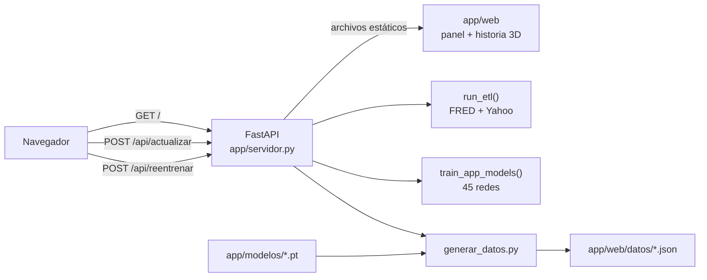

[← Volver al README](../README.md) &nbsp;|&nbsp; [Cómo se hizo](metodologia.md) &nbsp;|&nbsp; [Resultados](resultados.md) &nbsp;|&nbsp; [Guía de la web](aplicacion.md) &nbsp;|&nbsp; [Reproducirlo](reproducir.md)

# Guía de la web

Qué ofrece cada página de la web, cómo está montada y cómo ejecutarla o desplegarla.

**En esta página:**

- [Qué es](#qué-es)

---

## Qué es

La aplicación está en [`app/`](../app/): un servidor **FastAPI** que sirve una web estática (HTML, CSS y JavaScript, con una historia en 3D hecha con Three.js) y ejecuta los modelos en Python.

**Qué ofrece:**
- **Panel:** previsión a 1 semana, 3 meses y 1 año con su intervalo del 80 % y un **indicador de fiabilidad** por plazo (*aporta valor*, *orientativa* o *poco fiable*), calculado a partir de los resultados del test.
- **Escenarios:** simulador de sucesos (recorte de la OPEP+, recesión, cierre de Ormuz), coste de una compra de crudo en euros y probabilidad de que el precio supere un umbral, con la distribución del intervalo.
- **Mercado:** señales del mercado (volatilidad, VIX, euro/dólar, diferencial Brent-WTI), otros activos y los ciclos del precio desde 2000.
- **Fiabilidad:** lo que predijo el modelo en el test frente al precio real y frente al modelo ingenuo, la comparación de las tres redes en cada plazo con el modelo final marcado, cómo funciona el modelo y dos botones que llaman al backend: **actualizar datos** (descarga lo último de FRED y Yahoo y recalcula la previsión con los modelos guardados) y **reentrenar** (vuelve a entrenar las redes con todos los datos, en segundo plano).
- **Resultados:** el trabajo de entrenamiento en tres pasos: las curvas de aprendizaje de cada red con la época de parada temprana, la validación y el test.
- **Terminal:** vista avanzada con capas (medias móviles, las tres redes, velas, escala logarítmica), comparación con otros activos, herramientas para marcar puntos, trazar líneas y medir la variación entre dos días, una calculadora de inversión en euros (con comisión y apalancamiento) y un modo práctica que oculta el futuro para operar día a día y compararse con comprar y mantener o con seguir al modelo.
- **Historia:** un recorrido en 3D por los grandes picos y valles del Brent desde 2000.



La aplicación usa el modelo final **reentrenado con todos los datos disponibles** (5 semillas de cada red y horizonte, 45 modelos pequeños, 1,8 MB en total).

**Ejecutarla en local:**

```bash
poetry run uvicorn servidor:app --app-dir app --port 7860
```

y abrir <http://localhost:7860>.

**Desplegarla en Hugging Face Spaces** (Docker):

```bash
poetry run python scripts/preparar_space.py
```

```bash
hf upload <usuario>/<space> build/space . --repo-type space
```

El primer comando monta en `build/space/` todo lo que necesita el Space (servidor, web, modelos, paquete `oil_forecast`, datos, [`Dockerfile`](../app/Dockerfile) y [`requirements.txt`](../app/requirements.txt)) y el segundo lo sube.

---

[← Volver al README](../README.md) &nbsp;|&nbsp; [Cómo se hizo](metodologia.md) &nbsp;|&nbsp; [Resultados](resultados.md) &nbsp;|&nbsp; [Guía de la web](aplicacion.md) &nbsp;|&nbsp; [Reproducirlo](reproducir.md)
