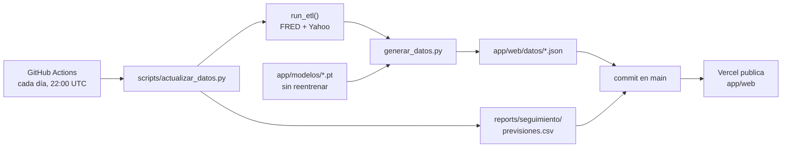

[← Volver al README](../README.md) &nbsp;|&nbsp; [Cómo se hizo](metodologia.md) &nbsp;|&nbsp; [Resultados](resultados.md) &nbsp;|&nbsp; [Guía de la web](aplicacion.md) &nbsp;|&nbsp; [Reproducirlo](reproducir.md)

# Guía de la web

Qué ofrece cada página de la web, cómo está montada y cómo ejecutarla o desplegarla.

**En esta página:**

- [Qué es](#qué-es)

---

## Qué es

La aplicación está en [`app/`](../app/): una web estática (HTML, CSS y JavaScript, con una historia en 3D hecha con Three.js) que lee sus datos de `app/web/datos/*.json`. Está publicada en **[prediccionpetroleornn-web.vercel.app](https://prediccionpetroleornn-web.vercel.app/)** y un workflow de GitHub Actions rehace esos datos cada día con los modelos guardados. En local también se puede servir con un servidor **FastAPI** que ejecuta los modelos en Python a demanda.

**Qué ofrece:**
- **Panel:** previsión a 1 semana, 3 meses y 1 año con su intervalo del 80 % y un **indicador de fiabilidad** por plazo (*aporta valor*, *orientativa* o *poco fiable*), calculado a partir de los resultados del test.
- **Escenarios:** simulador de sucesos (recorte de la OPEP+, recesión, cierre de Ormuz), coste de una compra de crudo en euros y probabilidad de que el precio supere un umbral, con la distribución del intervalo.
- **Fiabilidad:** lo que predijo el modelo en el test frente al precio real y frente al modelo ingenuo, la comparación de las tres redes en cada plazo con el modelo final marcado, cómo funciona el modelo y de qué fecha son los datos. En la web publicada explica la actualización diaria; con el servidor de Python en local muestra además dos botones: **actualizar datos** (descarga lo último de FRED y Yahoo y recalcula la previsión con los modelos guardados) y **reentrenar** (vuelve a entrenar las redes con todos los datos, en segundo plano).
- **Resultados:** el trabajo de entrenamiento en tres pasos: las curvas de aprendizaje de cada red con la época de parada temprana, la validación y el test.
- **Terminal:** vista avanzada con capas (medias móviles, las tres redes, velas, escala logarítmica), comparación con otros activos, herramientas para marcar puntos, trazar líneas y medir la variación entre dos días, una calculadora de inversión en euros (con comisión y apalancamiento) y un modo práctica que oculta el futuro para operar día a día y compararse con comprar y mantener o con seguir al modelo. Al final reúne lo que no es del modelo sino del mercado: los activos relacionados, cuatro señales (agitación del Brent, VIX, euro/dólar y diferencial Brent-WTI), los ciclos del precio desde 2000 y la variación mes a mes.
- **Historia:** un recorrido en 3D por los grandes picos y valles del Brent desde 2000.

La aplicación usa el modelo final **reentrenado con todos los datos disponibles hasta el 3 de noviembre de 2026** (5 semillas de cada red y horizonte, 45 modelos pequeños, 1,8 MB en total). Los pesos están en [`app/modelos/`](../app/modelos/) y también en [Hugging Face](https://huggingface.co/RubenElices/PREDICCION_PETROLEO_RNN).

**Cómo se publica y se actualiza:**



- **Publicación:** Vercel sirve la carpeta `app/web` como web estática (proyecto con *Root Directory* `app/web`, sin comando de build) y la vuelve a publicar con cada push a `main`.
- **Actualización diaria:** el workflow [`actualizar_datos.yml`](../.github/workflows/actualizar_datos.yml) ejecuta [`scripts/actualizar_datos.py`](../scripts/actualizar_datos.py) hasta el 30 de noviembre de 2026: descarga los datos, recalcula la previsión con los modelos guardados, apunta la previsión de cada día nuevo en el registro de seguimiento y, si hay un precio nuevo, hace commit. También se lanza a mano desde GitHub (*Actions → Actualizar datos → Run workflow*) o en local:

```bash
poetry run python scripts/actualizar_datos.py
```

- **Reentrenar** sigue siendo a mano: `poetry run python scripts/entrenar_app.py`.

**Ejecutarla en local con el servidor de Python** (con los botones de actualizar y reentrenar):

```bash
poetry run uvicorn servidor:app --app-dir app --port 7860
```

y abrir <http://localhost:7860>.

---

[← Volver al README](../README.md) &nbsp;|&nbsp; [Cómo se hizo](metodologia.md) &nbsp;|&nbsp; [Resultados](resultados.md) &nbsp;|&nbsp; [Guía de la web](aplicacion.md) &nbsp;|&nbsp; [Reproducirlo](reproducir.md)
