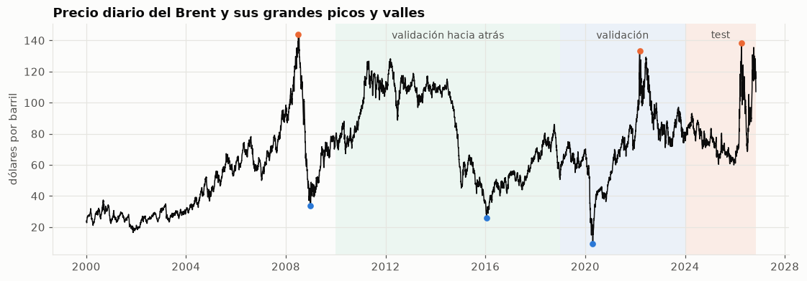
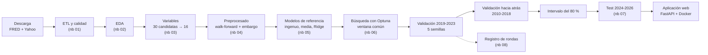
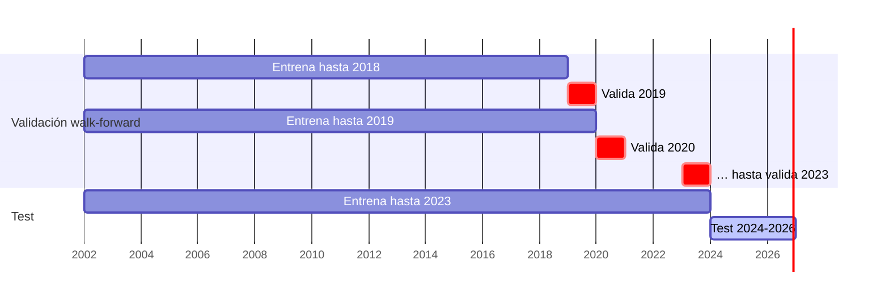
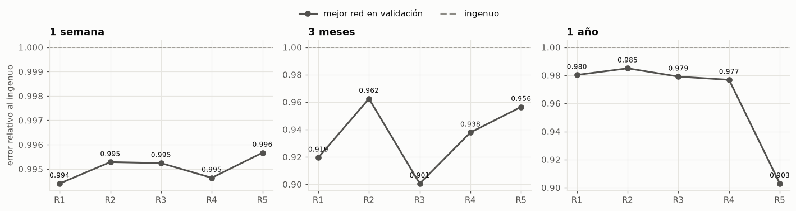
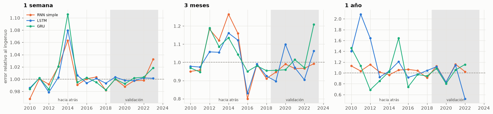
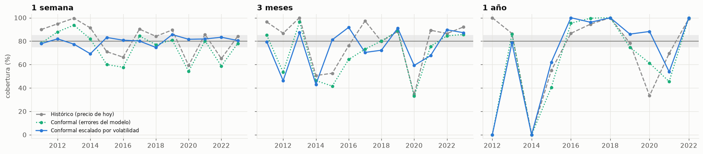

[← Volver al README](../README.md) &nbsp;|&nbsp; [Cómo se hizo](metodologia.md) &nbsp;|&nbsp; [Resultados](resultados.md) &nbsp;|&nbsp; [Guía de la web](aplicacion.md) &nbsp;|&nbsp; [Reproducirlo](reproducir.md)

# Cómo se hizo

El problema, los datos, la metodología de validación y las decisiones que llevaron al modelo final, ronda a ronda.

**En esta página:**

- [El problema](#el-problema)
- [Datos](#datos)
- [Pipeline de trabajo](#pipeline-de-trabajo)
- [Metodología](#metodología)
- [Cómo se llegó al modelo final](#cómo-se-llegó-al-modelo-final)
- [Validación y validación hacia atrás](#validación-y-validación-hacia-atrás)
- [Intervalo del 80 %](#intervalo-del-80-)

---

## El problema

Una empresa que compra combustible necesita saber cuánto costará el barril **dentro de una semana** (compras inmediatas), **dentro de tres meses** (presupuesto del trimestre) y **dentro de un año** (planificación y coberturas). El enunciado pide:

- Entrenar **RNN simple, LSTM y GRU** con las mismas condiciones (misma ventana de entrada, mismo presupuesto de búsqueda) para los tres horizontes.
- Validar con **walk-forward** (nunca entrenar con el futuro) y compararlas con un **modelo ingenuo**.
- Una tabla con **MAE, RMSE, mejora frente al ingenuo, número de parámetros y tiempo de entrenamiento**.
- Una **aplicación** que dé la previsión con un **intervalo del 80 %** y la explique.

El listón es el **modelo ingenuo**: el precio de hoy como previsión de cualquier fecha futura. Es la referencia estándar en precios de materias primas, y es difícil de batir porque el precio se comporta casi como un paseo aleatorio.

## Datos

21 series diarias desde el 1 de enero de 2000 hasta el 3 de noviembre de 2026 (6.501 días con precio del Brent), descargadas de fuentes públicas:

| Fuente | Series |
|---|---|
| **FRED** (Reserva Federal de St. Louis) | Brent y WTI al contado, gas natural Henry Hub, tipo de depósito del BCE, USD/EUR, CNY/USD, VIX |
| **Yahoo Finance** | Futuros del Brent y del WTI (apertura, máximo, mínimo, cierre y volumen), futuros de gas natural, cobre, oro, índice del dólar |

La serie incluye todos los grandes episodios: el máximo de 2008, la crisis financiera, el exceso de oferta de 2014-2016, el COVID-19 (con el WTI en negativo), la invasión de Ucrania y, dentro del test, la **guerra con Irán y el cierre del estrecho de Ormuz en 2026**, cuando el Brent pasó de 61 $ a 127 $ en un trimestre.

**Variables del modelo (16, elegidas en el notebook 03):**

| Grupo | Variables |
|---|---|
| Retornos diarios | Brent, futuro del WTI, futuro del gas, oro, cobre, índice del dólar, CNY/USD |
| Régimen de mercado | volatilidad a 21 y 63 días, caída desde el máximo del último año |
| Estructura y valor relativo | diferencial Brent-WTI, *basis* del WTI, ratios cobre/Brent y oro/Brent normalizados |
| Riesgo y política monetaria | log del VIX, cambio del tipo del BCE en 63 días |

## Pipeline de trabajo

| Notebook | Contenido |
|---|---|
| [`01_etl_calidad_datos`](../notebooks/01_etl_calidad_datos.ipynb) | Extracción, alineación de calendarios, antigüedad del dato, valores atípicos y decisiones de limpieza |
| [`02_eda`](../notebooks/02_eda.ipynb) | Ciclos del precio, propiedades estadísticas, estacionalidad, relación con otros mercados e incertidumbre por horizonte |
| [`03_feature_engineering`](../notebooks/03_feature_engineering.ipynb) | 30 variables candidatas, redundancia, relevancia, estabilidad en el tiempo y selección final de 16 |
| [`04_preprocesamiento`](../notebooks/04_preprocesamiento.ipynb) | Objetivo de cada horizonte, walk-forward con embargo, escalado sin fugas y secuencias de 20 días |
| [`05_baselines`](../notebooks/05_baselines.ipynb) | Modelo ingenuo, media histórica y regresión Ridge: el listón para las redes |
| [`06_ajuste_hiperparametros`](../notebooks/06_ajuste_hiperparametros.ipynb) | Cómo funciona cada celda, la elección de la ventana común, la búsqueda y las arquitecturas finales |
| [`07_comparativa_modelos`](../notebooks/07_comparativa_modelos.ipynb) | Test: tabla comparativa, estabilidad entre semillas, predicciones, intervalo, coste y conclusiones |
| [`08_registro_experimentos`](../notebooks/08_registro_experimentos.ipynb) | Todas las rondas de experimentos: qué se probó, qué salió y qué se decidió, con curvas de aprendizaje |

## Metodología

### Qué predicen las redes

Las redes no predicen el precio, sino el **retorno logarítmico a *h* días**, log(Pt+h / Pt), que es mucho más estable en el tiempo que el precio. La previsión en dólares es Pt · eretorno. Así, una red que predice retorno 0 es exactamente el modelo ingenuo, y cualquier mejora sobre él es información que la red ha encontrado en los datos.

### Validación sin mirar al futuro

- **Walk-forward por años:** para cada año de validación (2019 a 2023) se entrena solo con lo anterior. El error de validación es la media de los cinco años.
- **Embargo de *h* días** entre entrenamiento y evaluación: el objetivo de los últimos ejemplos de entrenamiento no puede caer dentro del periodo evaluado (a 1 año, eso supone dejar fuera 252 días).
- **Escalado sin fugas:** cada pliegue se normaliza solo con estadísticas de sus datos de entrenamiento. Hay tests automáticos que lo comprueban ([`tests/test_no_leakage.py`](../tests/test_no_leakage.py)).
- **Parada temprana** con el último 15 % del entrenamiento (respetando también el embargo): máximo 150 épocas y paciencia 15.

### Condiciones iguales para las tres redes

| | RNN simple, LSTM y GRU |
|---|---|
| Ventana de entrada | **20 días**, la misma para las tres (elegida entre 20 y 60 con una regla fijada de antemano) |
| Arquitectura | capa recurrente (1-2 capas de 16, 32 o 64 neuronas) + capa lineal de salida |
| Búsqueda | Optuna (TPE), **30 intentos por red y horizonte, 2 semillas por intento**, poda de intentos malos (*MedianPruner*) |
| Espacio de búsqueda | neuronas, capas, *dropout* 0-0,5, *learning rate* 3·10⁻⁵-10⁻³, lote 64/128/256, *weight decay* 10⁻⁶-10⁻³, pérdida MSE o Huber |
| Evaluación | media de **5 semillas** (*ensemble*); su dispersión mide la estabilidad |

### Reglas fijadas antes de mirar los resultados

Cada decisión (ventana, variante, peso de ajuste, modelo final, método del intervalo) se tomó con una **regla escrita antes de calcular**, guardada junto a los resultados en `reports/results/ronda_5/*_decision.json`. La versión **ajustada** de una red multiplica su retorno previsto por un peso entre 0 y 1 elegido en validación: con peso 0 es el ingenuo, y sirve para no sobreactuar cuando la red aporta poco.

## Cómo se llegó al modelo final

El modelo se construyó por rondas. Cada ronda prueba una idea y se decide siempre con la validación 2019-2023. El detalle completo, con todas las tablas, está en el [notebook 08](../notebooks/08_registro_experimentos.ipynb).

| Ronda | Qué se probó | Qué se aprendió |
|---|---|---|
| 1 | Primera búsqueda: 20 intentos por red, ventana de 60 días, 1 semilla | Con una sola semilla la validación es optimista |
| 2 | Búsqueda más amplia, validación con 5 semillas, versión ajustada | Cifras más realistas; cada red elegía su propia ventana, y el enunciado pide la misma |
| 3 | *Ensembles* de las 5 mejores configuraciones, más peso a los años recientes, modelo lineal en paralelo | Los *ensembles* ayudan; dar más peso a lo reciente empeora |
| 4 | Más semillas, menos variables, curvas de aprendizaje | Parte de la mejora anterior era azar; LSTM y GRU tenían demasiada capacidad y memorizaban |
| **5** | **Ventana común de 20 días**, nueva búsqueda con redes más pequeñas, sin tendencia del periodo de entrenamiento | **Modelo final**: cumple todas las condiciones del enunciado |

**Configuración final de cada red** (ventana de 20 días en todas; pérdida Huber en todas):

| Plazo | Red | Neuronas × capas | *Dropout* | *Learning rate* | Lote | Parámetros |
|---|---|---|---|---|---|---|
| 1 semana | RNN simple | 16 × 1 | 0,34 | 4,2·10⁻⁴ | 256 | 561 |
| | LSTM | 16 × 2 | 0,39 | 4,5·10⁻⁵ | 128 | 4.369 |
| | GRU | 32 × 1 | 0,17 | 3,8·10⁻⁵ | 256 | 4.833 |
| 3 meses | RNN simple | 64 × 2 | 0,47 | 6,9·10⁻⁴ | 128 | 13.633 |
| | LSTM | 64 × 1 | 0,01 | 7,2·10⁻⁴ | 128 | 21.057 |
| | GRU | 32 × 2 | 0,02 | 3,5·10⁻⁵ | 128 | 11.169 |
| 1 año | RNN simple | 16 × 2 | 0,04 | 3,1·10⁻⁵ | 256 | 1.105 |
| | LSTM | 32 × 2 | 0,20 | 3,0·10⁻⁵ | 128 | 14.881 |
| | GRU | 32 × 2 | 0,06 | 3,1·10⁻⁵ | 128 | 11.169 |

## Validación y validación hacia atrás

**Validación walk-forward 2019-2023** (RMSE relativo al ingenuo, media de los cinco años):

| Plazo | RNN simple | LSTM | GRU | Ridge | Modelo final |
|---|---|---|---|---|---|
| 1 semana | 1,003 | **1,000** | 1,003 | 0,998 | LSTM |
| 3 meses | **0,972** | 0,987 | 1,022 | 1,004 | RNN simple, peso 0,9 (0,972) |
| 1 año | 1,036 | **0,903** | 1,024 | 0,985 | LSTM |

El **modelo final** de cada horizonte es la red con menor error en validación, y quedó apuntado en [`modelo_final.json`](../reports/results/ronda_5/modelo_final.json) antes de calcular el test.

**Validación hacia atrás (2010-2018).** Cinco años de validación son pocos, y todas las decisiones se tomaron con ellos. Para comprobar si la ventaja es real, las configuraciones elegidas se reentrenaron **sin cambiar nada** para cada año de 2010 a 2018, solo con los datos anteriores a ese año. Regla: un modelo *se sostiene* si su error medio en todos los años (2010-2023) es menor que 1 y gana al ingenuo en al menos la mitad.

| Plazo | Modelo final | Media 2010-2023 | Años que gana | Veredicto |
|---|---|---|---|---|
| 1 semana | LSTM | 1,003 | 6 de 14 | no se sostiene (≈ ingenuo) |
| 3 meses | RNN simple, peso 0,9 | 1,008 | 10 de 14 | dudoso |
| 1 año | LSTM | 1,142 | 5 de 13 | no se sostiene |

Las redes aprenden sobre todo un patrón: **rebote tras una caída fuerte y volátil**. Acierta en 2009, 2016 y 2020, pero falla en 2014-2015 (la caída siguió) y en 2011-2013 (precio plano, donde el ingenuo es casi imbatible). La validación hacia atrás no cambia el modelo final, pero anticipa qué esperar en el test: a 1 semana empate y a 3 meses resultado frágil.

## Intervalo del 80 %

Se compararon tres métodos, calibrando cada año solo con lo que se sabía antes del 1 de enero de ese año:

| Método | Cómo se construye |
|---|---|
| **Histórico** | Centrado en el precio de hoy, con los percentiles 10 y 90 de los movimientos pasados a *h* días |
| **Conformal** | Centrado en la previsión de la red, con los percentiles de sus errores pasados |
| **Conformal escalado por volatilidad** | Como el conformal, pero los errores se dividen por la volatilidad de cada día y se multiplican por la de hoy: se ensancha cuando el mercado se agita |

**Regla:** entre los métodos con cobertura entre el 75 % y el 85 %, gana la menor puntuación de intervalo (anchura más penalización cuando el precio cae fuera); uno más sencillo a menos del 2 % gana.

| Plazo | Método elegido | Cobertura 2011-2023 (a 1 año, 2012-2022) | Cobertura en el test |
|---|---|---|---|
| 1 semana | Conformal escalado por volatilidad | 79,8 % | 78,9 % (77-80 % cada año) |
| 3 meses | Histórico | 78,9 % | 79,8 % (40 % en 2026) |
| 1 año | Histórico | 72,9 % | 87,0 % (orientativo, muy ancho) |

---

[← Volver al README](../README.md) &nbsp;|&nbsp; [Cómo se hizo](metodologia.md) &nbsp;|&nbsp; [Resultados](resultados.md) &nbsp;|&nbsp; [Guía de la web](aplicacion.md) &nbsp;|&nbsp; [Reproducirlo](reproducir.md)
