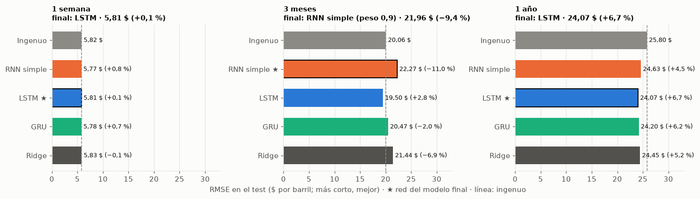
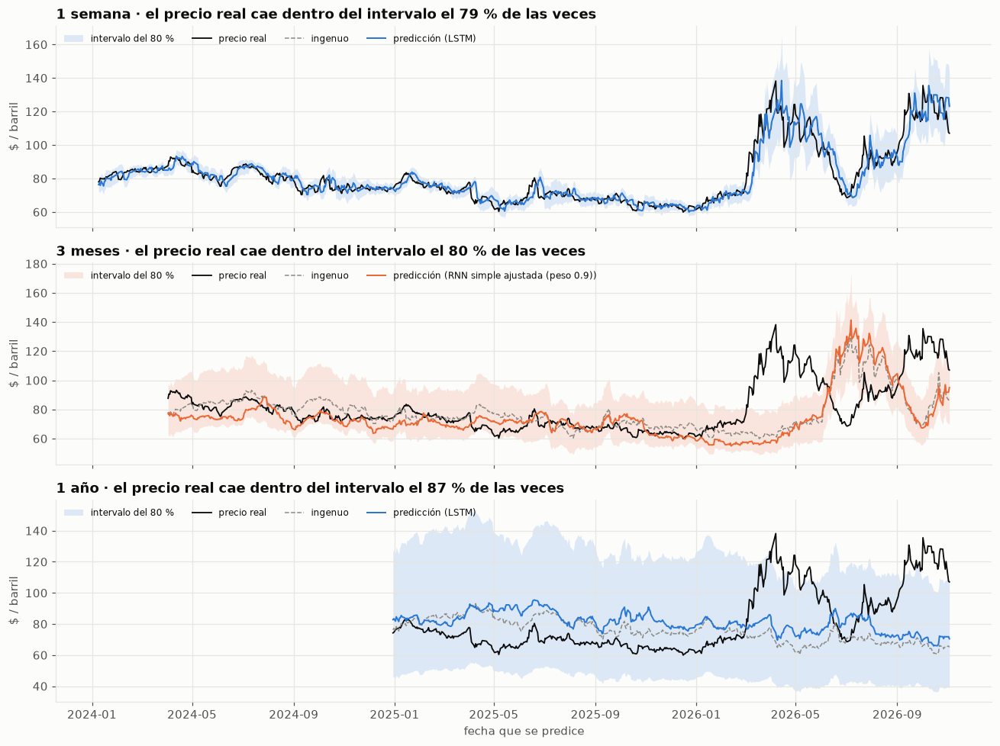

[← Volver al README](../README.md) &nbsp;|&nbsp; [Cómo se hizo](metodologia.md) &nbsp;|&nbsp; [Resultados](resultados.md) &nbsp;|&nbsp; [Guía de la web](aplicacion.md) &nbsp;|&nbsp; [Reproducirlo](reproducir.md)

# Resultados

Las cifras del test (enero de 2024 → noviembre de 2026), comparadas siempre con el modelo ingenuo, y lo que se concluye de ellas.

**En esta página:**

- [Resumen](#resumen)
- [Resultados en el test](#resultados-en-el-test)
- [Conclusiones y limitaciones](#conclusiones-y-limitaciones)

---

## Resumen

El modelo final de cada plazo frente al ingenuo, con las cuatro métricas: errores en dólares por barril y R² del cambio de precio, que es lo que predicen las redes (el ingenuo predice cambio cero):

| Plazo | Modelo final | RMSE: ingenuo → final | MAE: ingenuo → final | MSE ($²): ingenuo → final | R² del cambio: ingenuo → final |
|---|---|---|---|---|---|
| 1 semana | LSTM | 5,82 → 5,81 $ | 3,85 → 3,85 $ | 33,9 → 33,8 | −0,002 → 0,002 |
| 3 meses | RNN simple (peso 0,9) | 20,06 → 21,96 $ | 12,83 → 14,26 $ | 402,4 → 482,1 | −0,015 → −0,243 |
| 1 año | LSTM | 25,80 → **24,07 $** | 19,76 → 19,90 $ | 665,6 → **579,3** | −0,031 → **0,121** |

## Resultados en el test

Cada red se entrena con todos los datos anteriores a 2024 (con embargo) y 5 semillas. El test va de enero de 2024 al último día con objetivo conocido.

### Tabla comparativa (requisito del enunciado)

| Plazo | Modelo | MAE ($) | RMSE ($) | Mejora RMSE vs ingenuo | Parámetros | Tiempo por semilla |
|---|---|---|---|---|---|---|
| **1 semana** | Ingenuo | 3,85 | 5,82 | — | 0 | — |
| | Media histórica | 3,85 | 5,82 | 0,0 % | 1 | — |
| | Ridge | 3,85 | 5,83 | −0,1 % | 961 | — |
| | RNN simple | 3,83 | 5,77 | **+0,8 %** | 561 | 1,2 s |
| | LSTM | 3,85 | 5,81 | +0,1 % | 4.369 | 7,1 s |
| | GRU | 3,83 | 5,78 | +0,7 % | 4.833 | 5,7 s |
| **3 meses** | Ingenuo | 12,83 | 20,06 | — | 0 | — |
| | Media histórica | 12,91 | 20,05 | +0,1 % | 1 | — |
| | Ridge | 13,17 | 21,44 | −6,9 % | 961 | — |
| | RNN simple | 14,69 | 22,27 | −11,0 % | 13.633 | 2,8 s |
| | LSTM | 12,87 | 19,50 | **+2,8 %** | 21.057 | 3,0 s |
| | GRU | 12,79 | 20,47 | −2,0 % | 11.169 | 13,8 s |
| **1 año** | Ingenuo | 19,76 | 25,80 | — | 0 | — |
| | Media histórica | 21,22 | 25,52 | +1,1 % | 1 | — |
| | Ridge | 17,51 | 24,45 | +5,2 % | 961 | — |
| | RNN simple | 19,13 | 24,63 | +4,5 % | 1.105 | 4,7 s |
| | LSTM | 19,90 | 24,07 | **+6,7 %** | 14.881 | 9,2 s |
| | GRU | 17,43 | 24,20 | +6,2 % | 11.169 | 7,8 s |

El [notebook 07](../notebooks/07_comparativa_modelos.ipynb) completa la tabla con la mejora del MAE, el acierto de dirección, el p-valor de Diebold-Mariano (con corrección para predicciones solapadas) y un intervalo de confianza del 95 % de la mejora por *bootstrap* por bloques. Lo único claro del test es negativo: la RNN simple a 3 meses es peor que el ingenuo en todo su intervalo (de −19,6 % a −4,8 %). La LSTM a 3 meses va de −4,8 % a +4,8 %. A 1 año caben solo dos bloques de un año en el test, así que ese intervalo es orientativo.

### R²: cuánto explica cada modelo

El R² compara el error con el de predecir la media del periodo de test (1 es perfecto, 0 es igual que la media, negativo es peor). Esa media no se conoce de antemano, así que el R² solo tiene sentido al lado del ingenuo. Se da sobre el precio y sobre el cambio de precio a *h* días:

| Plazo | R² del precio: ingenuo / final | R² del cambio: ingenuo / final | R² del cambio: RNN simple / LSTM / GRU |
|---|---|---|---|
| 1 semana | 0,873 / 0,873 | −0,002 / 0,002 | 0,009 / 0,002 / 0,010 |
| 3 meses | −0,396 / −0,672 | −0,015 / −0,243 | −0,287 / **0,052** / −0,028 |
| 1 año | −0,706 / −0,485 | −0,031 / **0,121** | 0,070 / **0,121** / 0,107 |

- **El R² del precio engaña a 1 semana:** 0,873 parece un modelo excelente, pero el ingenuo saca lo mismo. Solo dice que el precio de dentro de una semana se parece al de hoy.
- **El R² del cambio de precio** da la misma lectura que el RMSE y el MAE: ninguna red explica el movimiento a 1 semana, el modelo final es peor que el ingenuo a 3 meses (solo la LSTM queda en positivo) y a 1 año la LSTM explica el 12 % de la variación del cambio de precio y la GRU el 10,7 %.
- A 3 meses y a 1 año el R² del precio es negativo incluso para el ingenuo: el precio se movió en un rango estrecho en 2024-2025 y después llegó el shock de 2026, así que los errores a esos plazos son grandes frente a la variación total del periodo.

### El modelo final frente a la realidad

| Plazo | Modelo final | Validación | Test | Lectura |
|---|---|---|---|---|
| 1 semana | LSTM | 1,000 | 0,999 | Igual que en validación: empata con el ingenuo |
| 3 meses | RNN simple, peso 0,9 | 0,972 | 1,094 | No se sostiene (−9,4 %; la RNN sin el ajuste pierde un 11,0 %). La validación hacia atrás ya lo marcaba como dudoso |
| 1 año | LSTM | 0,903 | **0,933** | Baja el RMSE en validación y en el test, con las 5 semillas a favor; el error medio no mejora |

**Qué decide el resultado:** el shock de 2026. A 1 año, la LSTM pierde en 2025 (anticipaba precios más altos de los que hubo) y gana en 2026, cuando la guerra llevó el precio a la zona que predecía. A 3 meses, la GRU y Ridge iban bien en 2024-2025 y pierden en 2026. El análisis año a año y la ventaja acumulada frente al ingenuo están en el [notebook 07](../notebooks/07_comparativa_modelos.ipynb).

## Conclusiones y limitaciones

1. **A 1 semana ninguna red aporta sobre el ingenuo**, como cabe esperar en precios de materias primas. Aquí el valor está en el **intervalo**: el método conformal escalado por volatilidad cubre el 79 % en el test y se mantiene estable incluso en 2026.
2. **A 3 meses los resultados son frágiles.** La red mejor en validación (RNN simple) pierde un 9,4 % en el test con el ajuste de peso 0,9 que se fijó en validación (un 11,0 % sin él) y varía mucho entre semillas: sus curvas de aprendizaje muestran que alcanza su mejor punto en pocas épocas y luego memoriza. La LSTM, más estable, mejora un 2,8 %.
3. **A 1 año la LSTM baja el RMSE un 6,7 %**, con las 5 semillas a favor, y es el único horizonte en el que el modelo final gana en validación y en el test. Pero no mejora el error medio (MAE −0,7 %), y la ventaja se acumula en 2026, con el shock de Ormuz. La GRU es más regular: baja el RMSE un 6,2 % y el MAE un 11,8 %, y gana en 2025 y en 2026.
4. **Entre arquitecturas, la LSTM es la más consistente**: es la única que mejora al ingenuo a 3 meses y a 1 año, en validación y en el test. La RNN simple es la más barata de entrenar, pero la más inestable. La GRU queda en medio.
5. **Una regresión lineal (Ridge) queda cerca** a 1 año (+5,2 %): con unos 6.000 días de datos y un problema tan ruidoso, la ventaja de las redes recurrentes es pequeña.
6. **Las cuatro métricas cuentan lo mismo.** RMSE, MAE, MSE y R² del cambio de precio coinciden: empate a 1 semana, peor a 3 meses y algo de señal a 1 año (R² de 0,12). El R² del precio, en cambio, sale alto a 1 semana para cualquier modelo y no sirve para compararlos.

**Limitaciones:**
- Ninguna red mejora al ingenuo de forma significativa: el test tiene casi tres años (menos de dos de objetivos a 1 año), y a 1 año las predicciones se solapan casi por completo.
- El resultado depende mucho de un único shock (2026). Con otro periodo de test, la ordenación de las redes podría cambiar.
- Los modelos solo ven datos de mercado. No tienen información de oferta (OPEP+, inventarios) ni de geopolítica, que son las que mueven los grandes cambios de precio.
- La evaluación supone que el precio de cada día se conoce ese mismo día, igual que el modelo ingenuo del enunciado. En la práctica, el Brent al contado de FRED se publica con varios días hábiles de retraso, y por eso la aplicación indica siempre de qué fecha es el último precio.

---

[← Volver al README](../README.md) &nbsp;|&nbsp; [Cómo se hizo](metodologia.md) &nbsp;|&nbsp; [Resultados](resultados.md) &nbsp;|&nbsp; [Guía de la web](aplicacion.md) &nbsp;|&nbsp; [Reproducirlo](reproducir.md)
